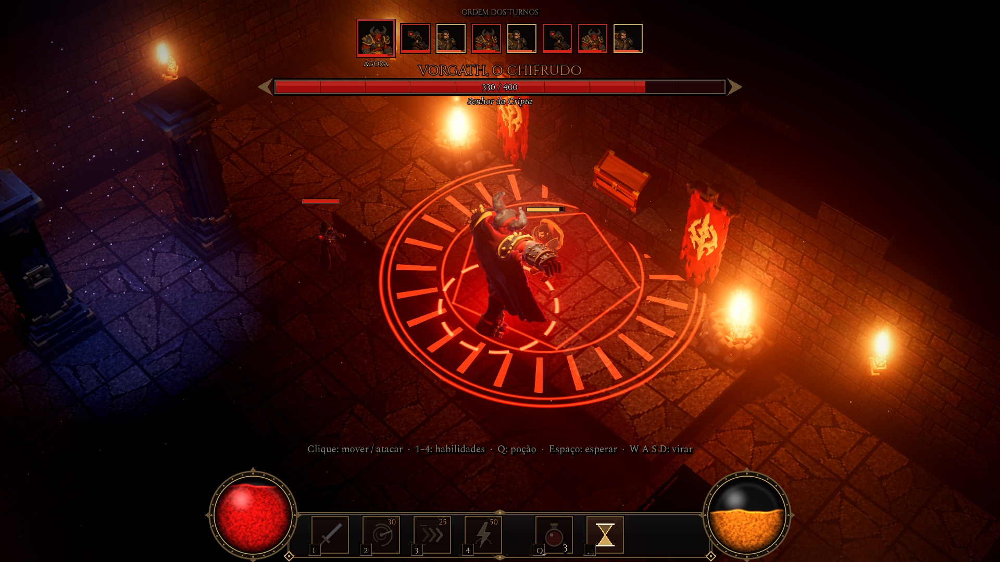

# Cripta de Cinzas

ARPG tático isométrico em voxel, feito no Godot 4.7. Uma cripta de 3 salas, combate por turnos, 4 tipos de monstro, um chefe e um baú no fundo da última sala.

**[Jogue no navegador](https://viktorkav.com.br/cripta-de-cinzas/)**



O jogo nasceu num vídeo do canal [ViktorKav](https://www.youtube.com/@vkav). O código (GDScript e shaders) foi escrito pelo Claude Opus 5.5 no Claude Code. Os 14 modelos 3D saíram do Agentic Canvas da Tripo, com rig e PBR feitos lá. Os sons e as texturas de piso e parede são gerados por script.

Este repositório tem o projeto inteiro: o código, os assets que o jogo usa, os modelos como saíram da Tripo e as ferramentas que prepararam tudo. Pode baixar, mexer, trocar os monstros e fazer a sua masmorra, desde que não seja para uso comercial (veja [Licença](#licença)).

## Como rodar

Com Git e o [Godot 4.7](https://godotengine.org/download) (versão padrão, sem .NET) instalados:

```sh
git clone https://github.com/viktorkav/cripta-de-cinzas.git
cd cripta-de-cinzas
godot --path jogo --import
godot --path jogo
```

O primeiro comando do Godot importa os modelos e as texturas (cerca de 20 segundos num Mac recente, mais em máquinas modestas); só é preciso uma vez. Se preferir o editor, abra `jogo/project.godot`, espere a importação terminar e aperte F5. No macOS, com o Godot em `/Applications`, um duplo clique em `jogo/jogar.command` abre o jogo depois da importação.

O download é de cerca de 180 MB, quase tudo modelo e textura.

## Controles

| Entrada | Ação |
|---|---|
| Clique | mover ou atacar |
| 1, 2, 3, 4 | Golpe, Redemoinho de Aço, Investida, Martelo dos Céus |
| Q | poção |
| Espaço | encerrar o turno |
| W, A, S, D | virar o herói |
| Z e C (ou `[` e `]`) | girar a câmera |
| Roda do mouse | zoom |
| Botão direito ou Esc | cancelar a habilidade; Esc também pausa |
| F11 ou Alt+Enter | tela cheia |
| F3 | contador de quadros por segundo |

## O que tem em cada pasta

| Pasta | Conteúdo |
|---|---|
| `jogo/` | o projeto Godot 4.7 (renderer Forward+): `scripts/`, `shaders/`, `scenes/` e `assets/` |
| `jogo/assets/models/` | os 14 modelos do jogo em GLB, já com rig e animações, as texturas de cor e, em `pbr/`, um mapa por modelo com roughness (canal G) e metallic (canal B) |
| `modelos-tripo/` | os arquivos como saíram do Agentic Canvas (FBX e GLB), antes de qualquer ajuste, incluindo o baú segmentado e o chefe reparado no AI 3D Lab |
| `ferramentas/` | os scripts que prepararam os assets e o que joga a cripta no automático |
| `web/` | o que muda na versão de navegador e como exportar ([web/README.md](web/README.md)) |

## Ferramentas

Os scripts de Blender rodam com `blender -b --factory-startup --python <script> -- <argumentos>`; os de Python puro pedem `numpy` e `Pillow`.

| Script | O que faz |
|---|---|
| `animar.py` | Blender: anima os rigs da Tripo (padrão Mixamo, 65 ossos) e exporta GLB. Uma definição de animação serve aos 6 personagens |
| `props.py` | Blender: converte os objetos de cenário em GLB, endireita o que veio torto e grava as medidas |
| `empacotar_pbr.py` | junta roughness e metallic dos mapas PBR da Tripo num PNG por modelo, no padrão ORM do glTF |
| `texturas.py` | gera as texturas de piso e parede, com normal map |
| `gen_sons.py` | sintetiza os efeitos sonoros (WAV) |
| `retratos.py`, `turntable.py`, `oblique.py` | Blender: retratos da interface e renders de conferência |
| `inspecionar.py`, `inspect_rig.py` | Blender: medidas de malha e de esqueleto |
| `rodar-partidas.sh` | joga a cripta sem janela, em várias sementes, e resume cada partida (foi assim que o jogo foi equilibrado) |

## Opções de linha de comando

Os argumentos do jogo vão depois de `--`:

```sh
godot --path jogo -- --autoplay --seed=3 --tempo=2
```

| Opção | Efeito |
|---|---|
| `--autoplay` | o jogo joga sozinho |
| `--seed=N` | semente da partida |
| `--tempo=X` | acelera o jogo X vezes |
| `--pular=N` | começa N salas adiante (`--pular=2` vai direto ao chefe) |
| `--sem_pbr` | volta ao material sem os mapas PBR, para comparar |
| `--log=arquivo` | grava o resumo da partida |

## Licença

- **Código** (`jogo/scripts/`, `jogo/shaders/`, `jogo/scenes/`, `jogo/project.godot`, `ferramentas/` e `web/`, menos `web/licencas/`): [PolyForm Noncommercial 1.0.0](LICENSE.md).
- **Assets** (modelos, texturas, mapas PBR, retratos, sons e imagens): [CC BY-NC 4.0](LICENSE-ASSETS.md), com o crédito "Cripta de Cinzas, de ViktorKav" e o link deste repositório.

Nas duas, você pode usar, estudar, modificar e compartilhar para fins pessoais, de estudo, de pesquisa ou em organizações sem fins lucrativos. Uso comercial precisa de autorização do autor.

De terceiros: as fontes Cinzel e Spectral têm seus avisos SIL OFL 1.1 em [`jogo/assets/fonts`](jogo/assets/fonts/). O Godot é distribuído sob a licença MIT; os avisos que acompanham a versão de navegador estão em [`web/licencas`](web/licencas/).
